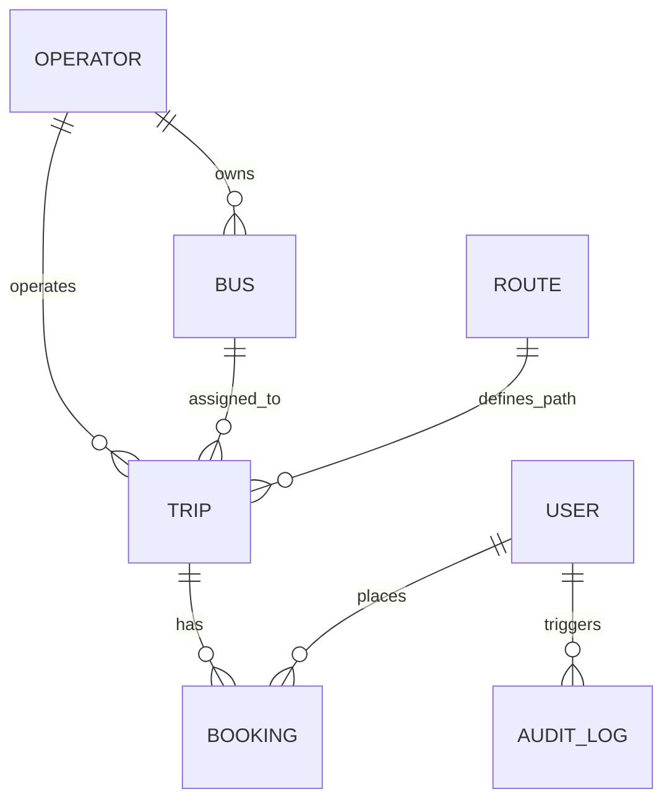

# Bus Booking Management System (MERN Stack)
> **Advanced Individual Project Assessment — Full-Stack Web Development**  
> **Candidate Repository**: [AyanAnwar78/busbooking](https://github.com/AyanAnwar78/busbooking)

---

## 📌 Executive Summary
BusGo is an enterprise-grade, responsive, database-backed **Bus Booking Management System** engineered with the **MERN** stack (MongoDB, Express.js, React.js, Node.js) and Tailwind CSS. It supports the complete operational journeys of both **passengers** (trip discovery, interactive seat layouts, atomic double-booking prevention, automated cancellation refunds) and **fleet operators/administrators** (fleet scheduling, live passenger manifests, occupancy reconciliation, and business audit trails).

---

## 🚀 Key Features & Acceptance Test Matrix

| Acceptance Criteria | Implementation Status | Evidence / Verification |
| :--- | :---: | :--- |
| **1. Trip Search & Seat Booking** | **Passed** | Search by origin, destination & date; select seats on visual 2x2 map; creates booking with unique PNR. |
| **2. Concurrency & Race Condition Protection** | **Passed** | Atomic conditional document matching (`Trip.findOneAndUpdate`) ensures **zero duplicate bookings** under concurrent requests; exactly 1 succeeds (201) and competing request receives 409 Conflict. |
| **3. PNR & Passenger Detail Integrity** | **Passed** | Ticket references contain passenger names, assigned seat numbers, route origin/destination, dates, and timestamps. |
| **4. Cancellation & Refund Rules** | **Passed** | Multi-tier rules (>24h = 90%, 12-24h = 50%, <12h = 0%). Automatically releases seats back to the general pool immediately. |
| **5. Manifest & Occupancy Reconciliation** | **Passed** | Operator manifest reconciles confirmed passengers with vehicle occupancy percentage and revenue stats. |

---

## 🏗️ System Architecture & Technology Stack

- **Frontend**: React 18, Vite, Tailwind CSS, Lucide Icons, React Router DOM, Axios
- **Backend**: Node.js, Express.js (Modular Monolith: Controllers, Services, Models, Routes, Middleware)
- **Database**: MongoDB Atlas / Mongoose (Indexed schemas, atomic arrays, validations)
- **Security & RBAC**: JWT Bearer Tokens, Bcrypt password hashing, Server-Side Role-Based Access Control (`customer`, `operator`, `admin`)
- **Automated Testing**: Jest, Supertest, MongoDB Memory Server / Atlas test runner

### Entity-Relationship (ER) Diagram
For detailed schema models and data dictionaries, refer to [docs/ER_DIAGRAM.md](docs/ER_DIAGRAM.md).



---

## 🔑 Demo Accounts & Credentials

The database comes pre-seeded with realistic operators, buses, scheduled trips, and accounts with pre-assigned roles:

| Role | Email Address | Password | Permissions |
| :--- | :--- | :--- | :--- |
| **Admin** | `admin@busbooking.com` | `AdminPassword@123` | Full access, system audit logs, fleet overview |
| **Operator** | `operator@kallada.com` | `OperatorPassword@123` | Fleet schedule, passenger manifests, occupancy |
| **Customer 1** | `john@example.com` | `CustomerPassword@123` | Search, book seats, view tickets, cancel bookings |
| **Customer 2** | `priya@example.com` | `CustomerPassword@123` | Search, book seats, view tickets, cancel bookings |

> *Tip: The web interface includes **1-Click Demo Login** buttons on the Sign-In screen for instant evaluation.*

---

## 💻 Local Setup & Execution Guide

### Prerequisites
- Node.js (v18+ recommended, v22 supported)
- npm (v9+)
- MongoDB Atlas connection string (or local MongoDB on port 27017)

### 1. Clone Repository
```bash
git clone https://github.com/AyanAnwar78/busbooking.git
cd busbooking
```

### 2. Backend Setup
```bash
cd backend
npm install
```

Configure your environment variables in `backend/.env`:
```env
PORT=5000
NODE_ENV=development
MONGO_URI=mongodb+srv://<username>:<password>@cluster0.1infltt.mongodb.net/bus_booking?retryWrites=true&w=majority
JWT_SECRET=supersecret_busbooking_production_key_2026
```

Seed the database with sample operators, buses, routes, trips, and confirmed manifests:
```bash
npm run seed
```

Run the backend server:
```bash
npm start
# Server runs on http://localhost:5000
# Health check available at: http://localhost:5000/api/health
```

### 3. Frontend Setup
In a new terminal window:
```bash
cd frontend
npm install
npm run dev
# Frontend runs on http://localhost:5173
```

---

## 🧪 Running Automated Tests

Run the test suite verifying all 5 core acceptance criteria, concurrency conflict handling, and manifest reconciliation:

```bash
cd backend
npm test
```

### Test Suite Output Evidence:
```text
PASS tests/acceptance.test.js
  Bus Booking Management System - Acceptance Tests
    √ Acceptance Test 1: Passenger can search a valid trip and book an available seat (1203 ms)
    √ Acceptance Test 2: Two simultaneous requests cannot confirm the same seat on one trip (748 ms)
    √ Acceptance Test 3: The PNR includes correct passenger, route, date and seat details (865 ms)
    √ Acceptance Test 4: Cancellation changes seat availability and refund status according to the rule (796 ms)
    √ Acceptance Test 5: Operator manifest and occupancy summaries reconcile with confirmed tickets (957 ms)

Test Suites: 1 passed, 1 total
Tests:       5 passed, 5 total
```

---

## 📂 Project Structure

```
busbooking/
├── backend/
│   ├── src/
│   │   ├── config/            # Database connection configuration
│   │   ├── controllers/       # Auth, Booking, Trip, Report, Bus, Route, Audit
│   │   ├── middleware/        # JWT Authentication, RBAC guards, Central Error Handler
│   │   ├── models/            # Mongoose Schemas (User, Operator, Bus, Route, Trip, Booking, AuditLog)
│   │   ├── routes/            # Express REST Route Handlers
│   │   ├── seeds/             # Seed data script for instant setup
│   │   ├── services/          # Core Concurrency Engine & Refund Math
│   │   ├── app.js             # Express application setup
│   │   └── server.js          # HTTP Server listener
│   ├── tests/                 # Acceptance & Concurrency Automated Tests
│   ├── .env.example
│   └── package.json
├── frontend/
│   ├── src/
│   │   ├── api/               # Axios client with JWT interceptor
│   │   ├── components/        # Navbar, Footer, SeatLayout, TicketCard, ProtectedRoute
│   │   ├── context/           # AuthContext (state, tokens, roles)
│   │   ├── pages/             # Home, SearchResults, SeatSelect, Confirm, MyBookings, Dashboard, Manifest, Audit
│   │   ├── App.jsx            # Router and Application Layout
│   │   └── main.jsx
│   ├── index.html
│   ├── vite.config.js
│   ├── tailwind.config.js
│   └── package.json
├── docs/
│   ├── ER_DIAGRAM.md          # Entity-Relationship diagram and schema specs
│   ├── ARCHITECTURE.md        # Concurrency design, RBAC model, layer architecture
│   ├── API_DOCUMENTATION.md   # Complete REST API contracts
│   └── TECHNICAL_REPORT.md    # Technical report for assessment submission
└── README.md
```

---

## 📝 Submission Checklist Verification

- [x] Full-Stack MERN source code in repository.
- [x] Environment variable placeholder `.env.example` included (real secrets not committed).
- [x] Repeatable seed database script (`npm run seed`).
- [x] 5 Acceptance tests implemented and automated (`npm test`).
- [x] ER diagram and Architecture documentation in `/docs`.
- [x] Technical report explaining design choices and concurrency handling.
- [x] Demo user credentials documented and accessible with 1-click in the UI.

---
© 2026 BusGo Management System — All rights reserved.
