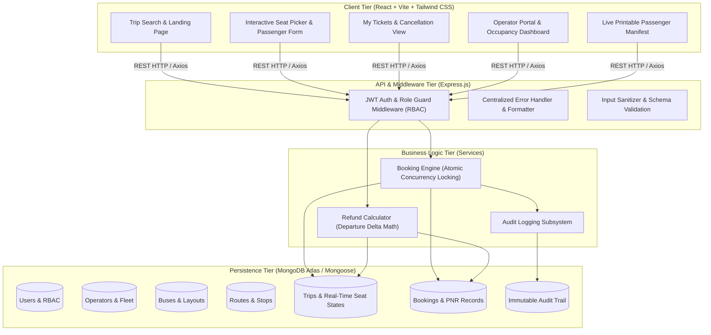

# System Architecture Documentation

## 1. High-Level Architecture Overview

The system is designed as a **Modular Monolith** in accordance with the assessment requirements, achieving strict separation of concerns among the Presentation Tier, API & Business Logic Tier, and the Persistence Tier.



---

## 2. Server-Side Role-Based Access Control (RBAC)

The application enforces security at the controller and route middleware layers. Hiding UI elements is purely cosmetic; every protected endpoint verifies the JWT identity and asserts user privilege:

| Endpoint Pattern | Method | Minimum Role Required | Purpose |
| :--- | :--- | :--- | :--- |
| `/api/auth/register` | `POST` | Public | Register new customer accounts |
| `/api/auth/login` | `POST` | Public | Authenticate user & issue signed JWT |
| `/api/trips/search` | `GET` | Public | Search scheduled buses by origin, dest & date |
| `/api/trips/:id` | `GET` | Public | Retrieve bus seat layout and live availability |
| `/api/bookings` | `POST` | `customer` | Atomically book selected seats and generate PNR |
| `/api/bookings/my` | `GET` | `customer` | View customer's own booking history |
| `/api/bookings/:id/cancel`| `PATCH`| `customer` (Owner) / `operator` / `admin` | Cancel booking and release seats back |
| `/api/reports/manifest/:id`| `GET` | `operator`, `admin` | Real-time passenger manifest |
| `/api/reports/occupancy` | `GET` | `operator`, `admin` | Route occupancy summaries & revenue metrics |
| `/api/reports/dashboard` | `GET` | `operator`, `admin` | System-wide performance and fleet stats |
| `/api/audit` | `GET` | `admin` | Immutable business action audit log ledger |

---

## 3. Concurrency Protection & Double-Booking Prevention

### The Race Condition Challenge
When two users concurrently view the same trip with 1 remaining seat (e.g. `1A`) and submit booking requests simultaneously at timestamp $T_0$, naive systems read the seat as available and insert two separate bookings, resulting in double-booking.

### Our Solution: Atomic Document Matching
In MongoDB, operations on a single document are atomic. We utilize conditional atomic queries with `findOneAndUpdate`:

```javascript
const seatElemMatches = seatNumbers.map((sNo) => ({
  $elemMatch: { seatNumber: sNo, status: 'AVAILABLE' }
}));

const updatedTrip = await Trip.findOneAndUpdate(
  {
    _id: tripId,
    status: 'SCHEDULED',
    seats: { $all: seatElemMatches } // Must ALL be available at this exact microsecond
  },
  {
    $set: {
      'seats.$[s0].status': 'BOOKED',
      'seats.$[s0].bookingId': bookingObjectId
    },
    $inc: { availableSeatCount: -seatNumbers.length }
  },
  {
    arrayFilters: [{ 's0.seatNumber': '1A', 's0.status': 'AVAILABLE' }],
    new: true
  }
);

if (!updatedTrip) {
  // Concurrent update failed: seat was claimed by another thread
  const error = new Error('Concurrency conflict: Seat already booked.');
  error.statusCode = 409;
  throw error;
}
```

**Outcome**: Exactly one request locks the seat and creates the booking (`201 Created`). The competing request receives `null` from `findOneAndUpdate` and immediately returns `409 Conflict`.
This behavior is verified in automated acceptance test #2.
