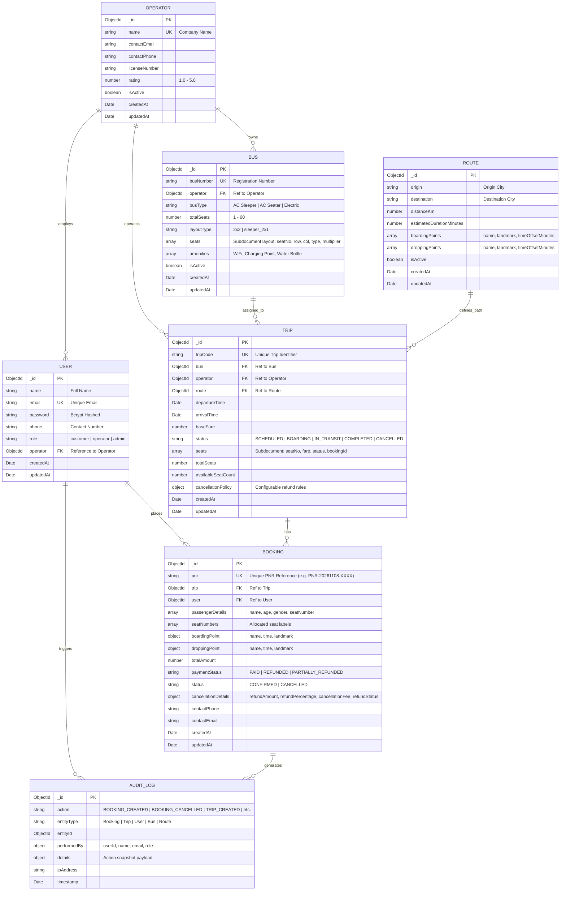

# Entity-Relationship (ER) Diagram
## Bus Booking Management System

---

### Key Relationships & Data Integrity Constraints

1. **Atomic Concurrency Protection**:
   - `Trip.seats` stores each seat's real-time reservation status (`AVAILABLE` vs `BOOKED`) and the associated `bookingId`.
   - Seat reservation executes via atomic document matching (`seats: { $all: [{ $elemMatch: { seatNumber: 'X', status: 'AVAILABLE' } }] }`), guaranteeing zero double-bookings under concurrent requests.
2. **Cancellation & Inventory Release**:
   - Cancelling a booking updates `Booking.status = 'CANCELLED'`, computes the refund according to `Trip.cancellationPolicy.rules`, and atomically resets `Trip.seats.status = 'AVAILABLE'` and increments `availableSeatCount`.
3. **Compound Indexes**:
   - `Route`: `{ origin: 1, destination: 1 }`
   - `Trip`: `{ route: 1, departureTime: 1, status: 1 }`
   - `Booking`: `{ pnr: 1 }` (Unique), `{ user: 1, createdAt: -1 }`, `{ trip: 1, status: 1 }`
   - `AuditLog`: `{ entityType: 1, entityId: 1 }`, `{ timestamp: -1 }`

